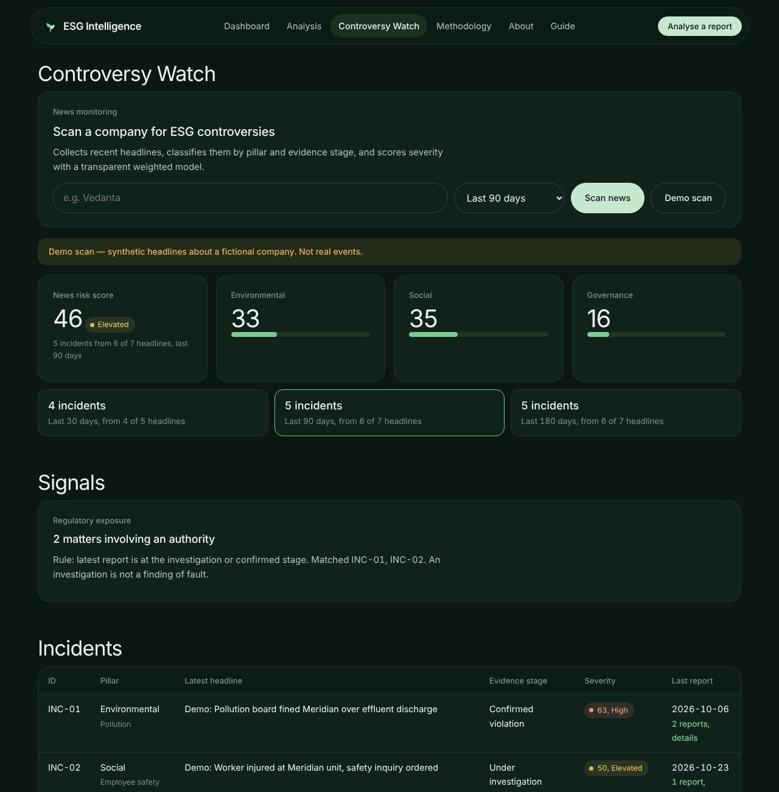
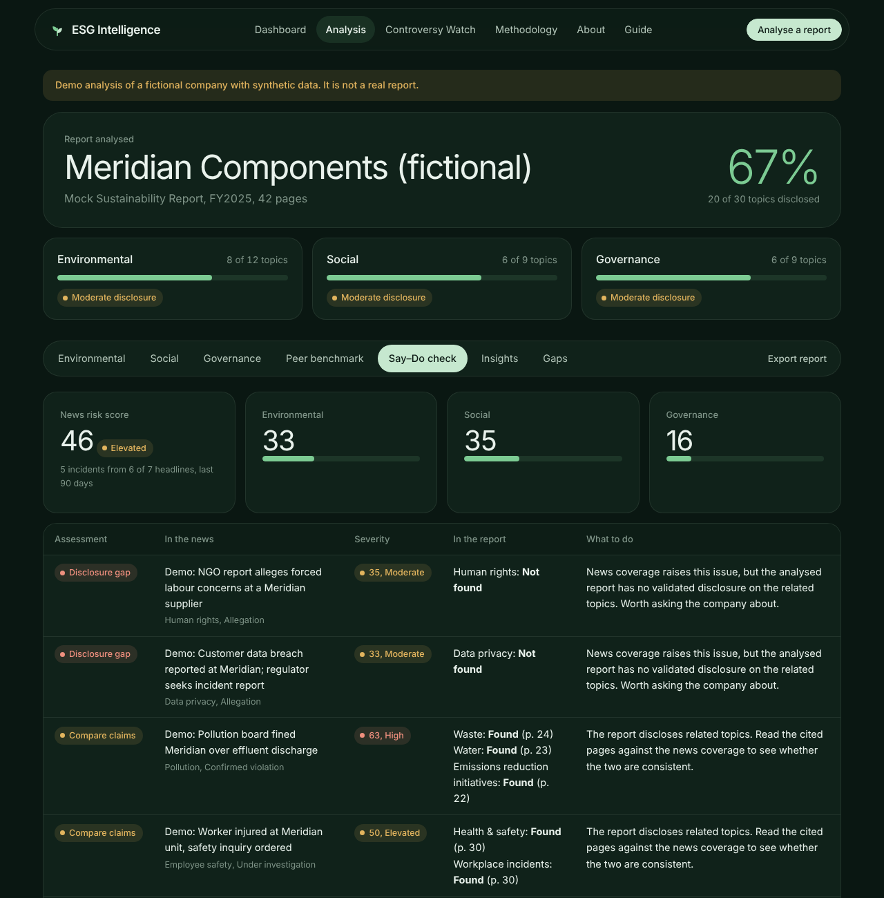

# ESG Intelligence Agent

[](https://github.com/trexiznub/esg-intelligence-agent/actions/workflows/tests.yml)

**Compares what a company says about ESG with what is reported about it.**

1. **Report discovery.** Pick one of 61 well-known Indian and global companies (`companies.json`) to find its ESG, sustainability, BRSR or annual report. Results are restricted to the company's official website domains, plus NSE/BSE filings that name the company, so other companies' pages never appear.
2. **Disclosure analysis.** Upload a sustainability report, annual report or BRSR (PDF). An agentic pipeline extracts ESG metrics, checks every quote against the source PDF and lists disclosure gaps.
3. **Controversy Watch.** Scans recent news for the company, classifies each headline by ESG pillar and evidence stage, and scores severity with a transparent weighted model.
4. **Say-do check.** Lines up each news controversy against the related topics in the report and flags where the report has no validated disclosure.

Live demo: https://trexiznub.github.io/esg-intelligence-agent/ — a short loading screen and a welcome guide explain how to use it. **View Demo** and **Demo scan** run without a backend on clearly labelled synthetic data.

| Controversy Watch | Say-do check |
|---|---|
|  |  |

*Screenshots show the built-in demo: synthetic headlines about a fictional company.*

This is a research prototype. It is **not** an ESG rating, assurance opinion, investment recommendation or compliance determination, and a news allegation is not a finding of fault.

## Architecture

```
Browser (index.html, no build step)
   |  upload PDF / company name                 polls /api/jobs/{id}
   v
FastAPI (backend/main.py)
   |
   +-- pipeline.py        report analysis, runs in a background thread
   |     1 Ingestion      PyMuPDF, page numbers kept, chunking
   |     2 Retrieval      TF-IDF search per ESG topic (taxonomy.py)
   |     3 ESG analysis   LLM, retrieved excerpts only
   |     4 Validation     deterministic: the quote must exist in the PDF
   |     5 Gap analysis   rule-based
   |     6 Insights       LLM, validated findings only
   |
   +-- controversy.py     Controversy Watch
   |     1 Collect        GDELT + Google News RSS (free, no key), de-duplicated
   |     2 Classify       one batched LLM call; labelled keyword rules as fallback
   |     3 Score          severity model, incidents, risk score, signals (pure code)
   |     4 Say-do check   incidents vs the report's validated findings (pure code)
   |
   +-- company_search.py  curated company list, search limited to official domains
   +-- report.py          PDF export (ReportLab)
```

## Tech stack

Python, FastAPI, PyMuPDF, Google Gemini API, ReportLab, vanilla JS/CSS frontend, pytest, GitHub Actions.

## Setup

Run everything from the repository root.

```bash
python -m venv .venv
source .venv/bin/activate              # Windows: .venv\Scripts\activate
pip install -r backend/requirements.txt
cp backend/.env.example backend/.env   # Windows: copy backend\.env.example backend\.env
# edit backend/.env and add your GEMINI_API_KEY
uvicorn backend.main:app --port 8000
```

Open http://localhost:8000.

| Variable | Purpose |
|---|---|
| `GEMINI_API_KEY` | Needed for report analysis and for LLM news classification. Server-side only, never sent to the browser. Without it, Controversy Watch still runs on keyword rules. |
| `GEMINI_MODEL` | Optional model override. |

## Tests

```bash
pip install -r requirements-dev.txt
python -m pytest -q
```

The 37 tests cover the scoring model, incident grouping, signals, the say-do check, news parsing and the company report search filter. They use no network and no API key.

## API

| Endpoint | Purpose |
|---|---|
| `POST /api/analyse` | Upload a PDF, returns a `job_id` |
| `POST /api/analyse-url` | Analyse a public PDF by URL (private and loopback addresses are refused) |
| `GET /api/jobs/{id}` | Real pipeline stage and, when done, the result |
| `GET /api/jobs/{id}/report` | PDF export of the analysis |
| `POST /api/company-search` | Find reports for a company from the supported list (others return 400) |
| `GET /companies.json` | The supported company list |
| `POST /api/controversies` | News scan for `{company, days}`; add `job_id` of a finished analysis to get the say-do check |

## How the scoring works

**Severity (0-100)** of one article is a weighted sum of seven factors multiplied by an evidence-stage factor, so an allegation scores lower than a confirmed violation with the same facts.

| Factor | Weight | | Evidence stage | Multiplier |
|---|---|---|---|---|
| Magnitude | 22% | | Allegation | 0.80 |
| Regulatory implications | 18% | | Under investigation | 0.92 |
| Scale of impact | 16% | | Confirmed violation | 1.00 |
| Reputational exposure | 16% | | Resolved | 0.55 |
| Financial implications | 14% | | | |
| Recurrence | 9% | | | |
| Source credibility | 5% | | | |

Articles on the same subcategory within 30 days form one **incident**; its latest article sets its current stage. The **news risk score** sums incident severities, halving each one every 45 days, and passes the total through a saturating curve so it cannot exceed 100.

The **say-do check** maps each of the 23 controversy subcategories to report topics (for example *Employee safety* to *Health & safety* and *Workplace incidents*) and returns one of:

- **Disclosure gap**: the news raises the issue and the report has no validated disclosure on the related topics.
- **Compare claims**: the report does disclose them, with page references to read against the coverage.
- **Not covered**: the report taxonomy has no matching topic.

## Known limitations

- Report search depends on a public search engine, so results vary and some reports are web pages rather than PDFs (those must be downloaded and uploaded). To add a company, add an entry with its official domains to `companies.json`.

- No OCR: scanned PDFs are rejected with a clear message. Tables can extract imperfectly.
- Retrieval is keyword-based (TF-IDF), not embeddings.
- Validation proves a quote exists in the PDF, not that the model interpreted it correctly.
- Controversy Watch reads headlines only, not article bodies, so confidence is modest. Dates are when the source first listed the article.
- Severity weights were tuned on synthetic data and have not been calibrated against real outcomes.
- Company matching is by name, so a common word used as a company name can pull in unrelated headlines.
- Jobs and news scans are held in memory and lost on restart. There is no sign-in and no rate limiting.

## How I explain it in an interview

"Most ESG tools either read the company's own report or track the news. I built both and connected them. The report side is an agentic pipeline: retrieval narrows a long PDF to relevant passages, the model extracts metrics with verbatim quotes, and a non-AI validation step checks each quote against the PDF before anything is shown. The news side classifies headlines by pillar and evidence stage, and a transparent weighted model scores severity so an allegation never counts the same as a confirmed violation. The say-do check then joins the two: if the news reports a data breach and the report says nothing about data privacy, that is flagged as a disclosure gap. The scoring is plain code with unit tests, and I state the limits openly, such as headline-only classification and uncalibrated weights."

---

© 2026 Ujwal Raj K.P.
